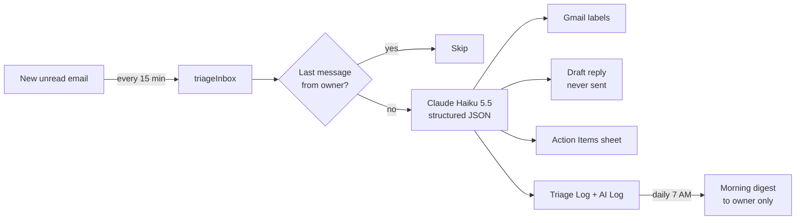

# AI Inbox Triage Agent


> **Every new email gets sorted, prioritized, and summarized. Routine replies are drafted for you, action items land
> in a tracker, and you get one morning digest instead of 80 unread emails.**

An AI assistant that runs inside your own Google account. It reads new mail every 15 minutes, labels each thread by
category and priority, drafts replies in your voice (it never sends them), pulls tasks into a Google Sheet, and emails
you a prioritized summary each morning.

---

## What it does

| | |
|---|---|
| 🏷️ **Sorts** | Labels each thread `Triage/<Category>` and `Priority/High · Normal · Low` |
| ✍️ **Drafts** | Writes threaded Gmail **drafts** for emails that need a reply. Nothing is ever sent automatically |
| ✅ **Extracts tasks** | Turns "send receipts by Friday" into a row in an Action Items sheet with a real due date |
| ☀️ **Summarizes** | Sends one morning digest: high-priority first, drafts waiting, open tasks |
| 🛡️ **Stays safe** | Treats email text as data, so instructions hidden in an email (prompt injection) are ignored and flagged |
| 📒 **Shows its work** | Every AI decision is logged with tokens and the raw output |

**Default categories** (editable in the sheet): Billing · Scheduling · Support/Complaint · Sales Lead · Vendor ·
Internal · Facilities/Urgent · Newsletter/Promo · FYI

## How it works



1. A time trigger finds unread inbox threads that haven't been triaged yet.
2. Each thread (up to ~8k characters, newest last) is sent to Claude with a strict JSON schema, so the reply always
   parses. Category and priority must come from fixed lists.
3. The script applies labels, creates a threaded draft if a reply is needed, and logs tasks and decisions to the sheet.
4. The `Triage` label marks a thread as done, so re-running never processes the same thread twice.

## Design principles

- **Human in the loop.** The agent drafts, you decide. The only email it sends is the digest, to you.
- **No invented facts.** Drafts never make up prices, dates, or commitments. Unknowns become `[CONFIRM: …]`
  placeholders.
- **Prompt-injection guard.** Email content is wrapped and marked as data. A test email that tells the AI to forward
  your mail is filed as FYI / Low with no reply.
- **Idempotent and bounded.** Labels act as the processed marker. Each run caps at 25 threads and 4.5 minutes, staying
  under Apps Script limits.
- **Your data stays in your account.** Gmail, Sheets, and Apps Script, plus Claude API calls. There's no separate
  server or database.

## Tech stack

- **Google Apps Script** (V8): Gmail, Sheets, time-driven triggers
- **Claude API**: `claude-haiku-5-5`, using structured outputs (JSON schema) and low effort for fast, cheap
  classification
- **clasp** for local development and deployment

**Estimated AI cost:** about $0.0005 per email on Haiku 5.5, roughly 2–4k tokens per thread. At 100 emails a day,
that's under $2/month.

## Project structure

| File | Purpose |
|---|---|
| [`Code.gs`](Code.gs) | Setup, triage loop, labeling, logging, morning digest, demo helpers |
| [`Claude.gs`](Claude.gs) | Claude API client: structured outputs, retries with backoff, AI Log |
| [`SampleData.gs`](SampleData.gs) | Sends 15 realistic fake emails, including a prompt-injection test, for a demo run |
| [`appsscript.json`](appsscript.json) | Manifest with the exact OAuth scopes |
| [`SPEC.md`](SPEC.md) | Functional spec and acceptance criteria |
| [`SETUP.md`](SETUP.md) | Step-by-step install and demo script |
| [`CHANGELOG.md`](CHANGELOG.md) | What was built and why |

## Quick start

```bash
npm install -g @google/clasp
clasp login
clasp create --type standalone --title "Inbox Triage Demo"
clasp push
```

Then, in the Apps Script editor:
1. Add the Script Property `ANTHROPIC_API_KEY`.
2. Run `setup()`.
3. Run `seedSampleData()` → `triageInbox()` → `sendMorningDigest()`.

Full walkthrough: **[SETUP.md](SETUP.md)**.

## Configuration

Everything a client would tune lives in the **Settings** tab of the generated sheet, so no code changes are needed:

| Setting | Default | |
|---|---|---|
| Owner name | Bob | Used to sign drafts |
| Categories | 9 defaults | Comma-separated; labels are created automatically |
| Archive promos | FALSE | Archive and mark read newsletters and promos |
| Digest hour | 7 | Hour of day for the morning digest |

## Adapting it for your business

- Swap the categories for your workflow, such as *Orders, Returns, Wholesale, Press*.
- Add a tone or style guide to the drafting prompt.
- Route action items to Asana, Trello, or Slack instead of a sheet.
- Use Claude Sonnet for drafts where the writing quality matters most.

## Safety notes

All demo data is fictional. Seeded emails are sent from the account to itself and tagged so they can be cleaned up
with `resetDemo()`. The API key lives in Script Properties and never in code.

## License

[MIT](LICENSE)
